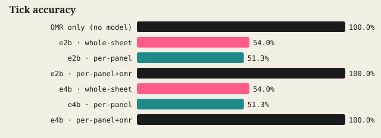

# Reader eval

> ⚠️ **These numbers come from the mock LLM (`scripts/mock-llm.ts`), not from Gemma.** They only prove the harness runs end to end. Run `pnpm eval:writer` and `pnpm eval:reader` against Ollama to get real numbers.

30 synthetic phone photos of filled-in sheets (`evals/out/sheets`): random ticks (✓ ✗ filled), handwriting in 3 fonts with jitter, rough sketches, a correct / close / wrong / blank riddle answer; perspective tilt, rotation, shadow gradient, blur and JPEG noise. Fiducials detected automatically on **30/30**.

| Reader | Tick accuracy | Handwriting CER (lower is better) | Riddle verdict accuracy | Seconds / sheet |
| --- | --- | --- | --- | --- |
| OMR only (no model) | 100.0% | — | — | 0.0 |
| gemma4:e2b · whole-sheet | 54.0% | 92.7% | 30% | 0.0 |
| gemma4:e2b · per-panel | 51.3% | 160.0% | 57% | 0.0 |
| gemma4:e2b · per-panel+omr | 100.0% | 160.0% | 57% | 0.0 |
| gemma4:e4b · whole-sheet | 54.0% | 92.7% | 30% | 0.0 |
| gemma4:e4b · per-panel | 51.3% | 160.0% | 57% | 0.0 |
| gemma4:e4b · per-panel+omr | 100.0% | 160.0% | 57% | 0.0 |

Close counts as right for riddle accuracy when the reader says "correct" for a misspelling (it's meant to be lenient).

